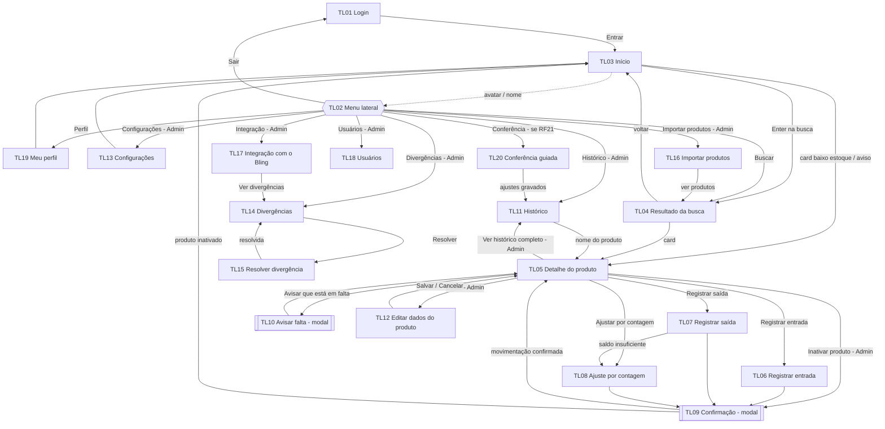

# Portal Óttimos — Design Brief de Front-End

> Especificação de design para geração das telas no **Figma** (importação de Markdown) ou, alternativamente, no **Google Stitch**.
> Fontes: *Briefing_Front-End_BLOX_Ottimos_Ferragens.xlsx* (fonte da verdade) e *BLOX - Wireframe.pdf* (9 páginas).
> Grupo: Alexandre Donisete, Claudiana Santos, João Sapia, Lesley Oliveira, Mauro Moreno e Tiago Silva — ADS 3º semestre, 2026/2.

## Visão geral

**Cliente:** Óttimos Ferragens, loja de ferragens com loja física e loja online (plataforma Wbuy). O ERP é o **Bling**, único lugar onde os produtos estão cadastrados; a Wbuy lê o saldo do Bling, então produto com saldo negativo no Bling aparece como "esgotado" no site.

**O que o Portal Óttimos é:** um sistema interno que **não substitui o Bling**: importa os produtos dele, registra as movimentações de estoque e sincroniza o saldo.

**Problema:** o saldo no Bling fica incorreto (inclusive negativo) porque entradas são contadas à mão, vendas de balcão nem sempre são lançadas e ninguém confere o estoque com rotina. Consequências:

1. Venda perdida: o produto está na prateleira mas aparece "esgotado" no site (maior dor relatada).
2. Retrabalho de recontar e corrigir negativos toda quarta-feira.
3. Compras decididas sem dado confiável.
4. Vendedores sem saber onde o produto está na loja.
5. Faltantes avisados ao dono em bloco de papel.

**Proposta de valor:** um único saldo de estoque confiável, em que toda entrada, saída e ajuste fica registrado com autor, data e motivo, as divergências com o Bling aparecem numa fila para correção e a equipe vê na tela inicial o que está com estoque baixo e onde cada produto fica na loja.

**Público-alvo:** funcionários internos da loja (não é para o cliente final da loja online). 6 usuários:

| Perfil | Qtd. | Quem | O que faz |
|---|---|---|---|
| Operador | 3 | Vendedores/balconistas | Buscam produto, registram entrada, saída e ajuste, avisam faltas |
| Admin | 3 | Dono, assistente e mais 1 pessoa | Tudo do Operador + usuários, estoque mínimo, divergências, importação, integração e histórico completo |

Parte da equipe é de funcionários antigos com dificuldade em sistemas: a interface precisa funcionar para quem usa pouco o computador, com **textos curtos, botões grandes e poucos passos por tarefa**.

**Plataforma:** web responsiva, **desktop-first**, acessada pelo navegador dos PCs de mesa da loja. Sem app mobile nativo na v1.

| Item | Valor |
|---|---|
| Layout de referência | Desktop **1366 × 768 px** |
| Sem rolagem horizontal a partir de | **1024 px** |
| Reflow em coluna única a partir de | **360 px** (celular pessoal do funcionário, uso eventual) |
| Stack | React + React Router + axios (REST/JSON, backend Spring Boot), Vite, CSS próprio |
| Tema | Claro, único na v1 |

**Identidade visual:** cores oficiais da Óttimos Ferragens: azul `#24235F`, amarelo `#F7EB0C` e branco (aplicado como `#FAFAFC`, **nunca** `#FFFFFF`). Barra superior azul com faixa amarela embaixo, botões principais azuis e cards brancos sobre fundo `#F1F1F6`. O amarelo aparece só como destaque (selo ADMIN, faixa do cabeçalho, foco sobre fundos azuis), **nunca como texto sobre branco**.

### Fora do escopo da v1 (NÃO desenhar)

CRM (lembretes de cadastro de cliente e de avaliação), alertas por e-mail ou WhatsApp, etiquetas QR/código de barras, mapa da loja, loja online e jornada do comprador, módulos fiscal/financeiro/compras/NF-e, relatórios avançados/BI, app mobile nativo, **criação de produto novo no Portal** (aba "Cadastrar produto": decisão pendente com o cliente) e a faixa de estoque "perto do limite".

---

## Persona

### P01 — Ronaldo, 34 anos · Vendedor de balcão (Operador)

- **Contexto:** trabalha das 8h às 18h no atendimento e ajuda a guardar mercadoria quando chega. Usa o PC do balcão entre um atendimento e outro, **de pé, com o cliente esperando**.
- **Objetivo:** descobrir em segundos se o produto existe, quanto tem e em que corredor/prateleira está; registrar entrada ou saída sem sair da tela do produto.
- **Dores:** sistema diz "esgotado" e o produto está na prateleira; produtos "se perdem" na prateleira; telas confusas atrasam o atendimento.
- **Familiaridade digital:** intermediária · **Dispositivo:** desktop.
- **Acessibilidade:** lê a tela a ~60 cm, de pé; saldo e localização em fonte grande (≥ 24 px); busca operável só com teclado (digitar + Enter).
- *"Se eu não achar o produto em 1 minuto, o cliente vai embora."*

**Implicações de design:** campo de busca em destaque com foco automático na tela Início; Enter executa a busca; saldo exibido no estilo *Saldo em destaque* (32 px/700); localização sempre visível nos cards e no detalhe; botões de movimentação logo abaixo dos dados do produto.

### P02 — Carlos, 42 anos · Dono da loja (Admin)

- **Contexto:** responsável pelo estoque e pelas compras. Decide o que repor olhando o Bling e os avisos de papel. Acessa o sistema algumas vezes ao dia, rapidamente.
- **Objetivo:** ver de relance o que está baixo ou em falta para decidir compras e saber quem movimentou o quê.
- **Dores:** compra sem dados confiáveis; perde vendas online por produtos marcados "esgotado" por engano; avisos de falta em papel se perdem.
- **Familiaridade digital:** intermediária · **Dispositivo:** desktop.
- **Acessibilidade:** resumo na tela, Início com números grandes (contadores) e informação principal sem precisar de filtros.
- *"Eu só quero saber o que está faltando e se posso confiar no número."*

**Implicações de design:** a tela Início mostra sem filtro os produtos com baixo estoque (do mais crítico) e os avisos de falta; contador de divergências visível no menu; Histórico legível em frases ("[Usuário] adicionou +10 un. de Martelo").

### P03 — Seu Valdir, 61 anos · Balconista há 20 anos (Operador)

- **Contexto:** conhece a loja de cor, mas usa pouco o computador e tem receio de "estragar algo". Hoje avisa faltas no bloco de papel e pede ajuda para lançar no Bling.
- **Objetivo:** avisar que um produto acabou e registrar a mercadoria que conferiu sem precisar pedir ajuda.
- **Dores:** menus com muitas opções, ícones sem nome, termos técnicos, mensagens de erro que não dizem o que fazer, medo de apagar algo sem querer.
- **Familiaridade digital:** iniciante · **Dispositivo:** desktop.
- **Acessibilidade:** texto base 18 px; botões grandes (≥ 44 px de altura) com texto; confirmação antes de qualquer gravação; nenhuma ação destrutiva disponível para o perfil dele.
- *"Me mostra onde clica que eu faço."*

**Implicações de design:** todo ícone acompanha texto; modal de confirmação (TL09) antes de toda gravação, mostrando o antes e o depois; Operador não vê "Editar", "Inativar produto" nem nenhum item ADMIN; motivo de saída como botões de opção grandes, não lista suspensa; mensagens de erro dizem o que fazer.

### P04 — Márcia, 38 anos · Assistente administrativa (Admin)

- **Contexto:** reserva as quartas-feiras para corrigir estoque negativo e organizar a loja. Provável responsável pelo estoque após a implantação. Usa o PC do escritório com mais calma.
- **Objetivo:** encontrar rápido o que está negativo ou divergente, corrigir com justificativa e acompanhar se a integração com o Bling funciona.
- **Dores:** passa horas conferindo e recontando, não sabe quem lançou errado, corrige no Bling e o problema volta.
- **Familiaridade digital:** avançada · **Dispositivo:** desktop.
- **Acessibilidade:** tabelas longas legíveis com zebra discreta, filtros persistentes e atalhos de teclado.
- *"Quero uma lista do que está errado, não o estoque inteiro para conferir."*

**Implicações de design:** fila de Divergências ordenada do maior para o menor impacto, com filtros; tabelas com zebra discreta (`cor-primaria-suave` em hover/seleção, `cor-divisoria` entre linhas); filtros do Histórico mantidos ao voltar à tela; tela de Integração com estado e horários explícitos.

---

## Design Tokens

### Cores

Proporção alvo: **60% branco** (`cor-branco` + `cor-fundo`), **30% azul** (cabeçalho, menu, botões principais), **10% amarelo** (item ativo, faixa do cabeçalho, selo Admin, foco sobre azul). Contraste calculado pela fórmula WCAG 2.1 (texto ≥ 4.5:1; bordas de componente e anel de foco ≥ 3:1).

| Token | HEX | RGB | Papel | Onde é usada | Par de contraste | Contraste | AA |
|---|---|---|---|---|---|---|---|
| `cor-primaria` | `#24235F` | 36, 35, 95 | Ação principal (azul oficial) | Cabeçalho, menu lateral, botão principal ("Entrar", "Buscar", "Registrar entrada"), links, títulos de destaque | `cor-branco` | 13.6:1 | Sim |
| `cor-primaria-hover` | `#35347F` | 53, 52, 127 | Hover da ação principal | Hover do botão principal e do item de menu sobre azul | `cor-branco` | 10.3:1 | Sim |
| `cor-primaria-suave` | `#E9E9F3` | 233, 233, 243 | Fundo / superfície | Linha selecionada ou em hover na tabela, fundo do filtro ativo, etiquetas neutras | `cor-primaria` | 11.8:1 | Sim |
| `cor-destaque` | `#F7EB0C` | 247, 235, 12 | Destaque (amarelo oficial) | **Só sobre azul ou como preenchimento com texto azul**: item ativo do menu, faixa de 4 px sob o cabeçalho, selo "ADMIN", anel de foco sobre azul. **Nunca** texto/ícone sobre branco (1.2:1) | `cor-primaria` | 11.4:1 | Sim |
| `cor-branco` | `#FAFAFC` | 250, 250, 252 | Fundo / superfície (branco oficial) | Cards, tabelas, formulários, campos, modais; texto sobre azul | `cor-texto` | 15.3:1 | Sim |
| `cor-fundo` | `#F1F1F6` | 241, 241, 246 | Fundo geral | Fundo da página atrás dos cards | `cor-texto` | 14.1:1 | Sim |
| `cor-texto` | `#222222` | 34, 34, 34 | Texto principal | Títulos, rótulos, saldo, texto corrido | sobre `cor-branco` | 15.3:1 | Sim |
| `cor-texto-secundario` | `#5A5A6E` | 90, 90, 110 | Texto secundário | Legendas, data/hora, ajuda, placeholders | sobre `cor-branco` / `cor-fundo` | 6.5:1 / 6.0:1 | Sim |
| `cor-texto-sobre-azul-secundario` | `#C9C9DD` | 201, 201, 221 | Texto secundário sobre azul | Textos secundários no cabeçalho e menu azuis (rótulo de grupo, perfil do usuário) | sobre `cor-primaria` | 8.7:1 | Sim |
| `cor-borda` | `#80809A` | 128, 128, 154 | Borda de componente | Borda de campos, botões secundários e cards clicáveis | sobre `cor-branco` | 3.7:1 | Sim (≥ 3:1) |
| `cor-divisoria` | `#E2E2EA` | 226, 226, 234 | Divisória decorativa | Linhas entre seções e linhas de tabela, contorno de card não clicável. **Não** usar como limite de campo ou botão | `cor-texto` | 12.3:1 | Sim |
| `cor-sucesso` | `#1E7B34` | 30, 123, 52 | Sucesso | Toast "Entrada registrada", "✓ OK", "Conectado", diferença positiva. Sempre ícone + texto | `cor-branco` | 5.1:1 | Sim |
| `cor-alerta` | `#855A00` | 133, 90, 0 | Alerta (âmbar escuro, ≠ amarelo de marca) | Texto, ícone ⚠ e borda do selo "Baixo", avisos de falta, faixa "Sem conexão com o Bling" | sobre `cor-alerta-fundo` | 5.6:1 | Sim |
| `cor-alerta-fundo` | `#FFF7CC` | 255, 247, 204 | Fundo de alerta | Fundo do selo e da faixa de alerta (sempre com texto `cor-alerta`) | `cor-alerta` | 5.6:1 | Sim |
| `cor-erro` | `#B42318` | 180, 35, 24 | Erro / destrutivo | Erro de campo, saldo negativo, divergência, contador de divergências, botões "Inativar produto"/"Desativar", "Sair" | `cor-branco` | 6.3:1 | Sim |
| `cor-informacao` | `#2F5BB7` | 47, 91, 183 | Informação | Etiquetas de origem no histórico (Pedido Bling, Nota, Manual, Conciliação), dicas, banners informativos | `cor-branco` | 6.1:1 | Sim |
| `cor-foco` | `#24235F` | 36, 35, 95 | Anel de foco | Contorno 3 px, afastamento 2 px, sobre fundos claros. Sobre azul, o anel usa `cor-destaque` (11.4:1) | sobre `cor-fundo` | 12.6:1 | Sim |

**Regras da paleta**

- Nenhum estado é indicado só por cor: sempre ícone e/ou texto junto.
- Alerta usa `cor-alerta` (âmbar), nunca `cor-destaque` (amarelo de marca).
- `#FFFFFF` não é usado em nenhum lugar.

### Tipografia

Fontes: **Inter** (interface) e **JetBrains Mono** (código do produto).

| Token / elemento | Fonte | Peso | Tamanho | Altura de linha | Uso |
|---|---|---|---|---|---|
| `texto-h1` | Inter | 700 | 28 px | 1.25 | Título da tela ("Início", "Histórico"). Uma vez por tela |
| `texto-h2` | Inter | 600 | 22 px | 1.3 | Título de seção/card ("Produtos com baixo estoque", "Avisos de falta") |
| `texto-h3` | Inter | 600 | 18 px | 1.35 | Nome do produto em cards e no cabeçalho do modal |
| `texto-base` | Inter | 400 | 16 px | 1.5 | Texto corrido e células de tabela. Nunca menor que 16 px em conteúdo principal |
| `texto-saldo` | Inter | 700 | 32 px | 1.1 | Número do saldo no detalhe e contadores do Início; unidade ao lado em 16 px/400 (ex.: "15 un.") |
| `texto-legenda` | Inter | 400 | 14 px | 1.4 | Data e hora, ajuda, rodapé de tabela. **Tamanho mínimo da interface** |
| `texto-rotulo` | Inter | 600 | 15 px | 1.4 | Rótulo sempre visível acima do campo; obrigatório marcado com "(obrigatório)" em texto |
| `texto-botao` | Inter | 600 | 16 px | 1 | Rótulo de botão, sempre com verbo |
| `texto-codigo` | JetBrains Mono | 500 | 15 px | 1.4 | Código do produto, sempre antes do nome: "1020 – Parafuso sextavado 6 mm" |

### Espaçamento (base 4 px)

| Token | Valor | Uso definido |
|---|---|---|
| `espaco-4` | 4 px | — |
| `espaco-8` | 8 px | — |
| `espaco-12` | 12 px | — |
| `espaco-16` | 16 px | Gap entre campos de formulário; margem da página no mobile |
| `espaco-24` | 24 px | Padding interno de card |
| `espaco-32` | 32 px | Margem da página no desktop |
| `espaco-48` | 48 px | — |

### Raio, sombra e área clicável

| Token | Valor | Uso |
|---|---|---|
| `raio-8` | 8 px | Campos, botões |
| `raio-12` | 12 px | Cards, modais |
| `sombra-sobreposicao` | `0 8px 24px rgba(0,0,0,0.5)` | **Somente** modal e menu suspenso. Cards não têm sombra: usam borda `cor-divisoria` |
| `area-clicavel-min` | 44 × 44 px | Ícones, linhas clicáveis, checkboxes (WCAG 2.5.5) |
| `altura-botao-principal` | 48 px | Botão principal |
| `altura-botao-secundario` | 44 px | Botão secundário |
| `altura-busca` | 56 px | Campo de busca do Início |

---

## Tom de Voz

Atributos: **Direto · Claro (sem jargão) · Útil no erro · Confiável · Respeitoso e paciente · Útil no vazio**. Trate o usuário por "você".

| Atributo | Na prática | ✅ Faça | ❌ Não faça | Onde aplica |
|---|---|---|---|---|
| Direto | Frases curtas, verbo no começo, uma ideia por frase. O botão diz exatamente o que vai acontecer. Títulos de 1 a 4 palavras, sem nome do sistema | "Registrar entrada" · "Salvar mínimo" · "Buscar" · "Produtos com estoque baixo" · "Histórico de movimentações" | "OK" · "Enviar" · "Processar solicitação" · "Bem-vindo ao Módulo de Gestão Inteligente Portal Óttimos" | Botões, títulos |
| Claro (sem jargão) | Palavras da loja: produto, quantidade, entrada, saída, contagem, prateleira. Avisos de sistema dizem desde quando e o impacto, sem alarmismo | "Não foi possível falar com o Bling. Suas alterações serão enviadas quando a conexão voltar." · "Sem conexão com o Bling desde 14:32. O Portal continua funcionando normalmente." | "Erro 502: falha no webhook / timeout na fila de saída." · "FALHA CRÍTICA DE INTEGRAÇÃO!" | Erros, notificações |
| Útil no erro | Todo erro diz o que aconteceu e o que fazer, sem culpar. Placeholder mostra exemplo do formato e nunca substitui o rótulo | "Não dá para tirar 5 un.: a quantidade atual é 2 un. Se o número na prateleira for outro, faça um ajuste por contagem." · Rótulo "Localização" + placeholder "Ex.: C3-P2 (corredor 3, prateleira 2)" | "Operação inválida." · "Você digitou errado." · Campo sem rótulo com placeholder "Digite aqui..." | Erros, ajuda, placeholders |
| Confiável | Confirmar o resultado com o número final. Confirmação antes de gravar mostra antes e depois, com "Voltar" e "Confirmar alteração" | "Entrada registrada. Quantidade agora: 15 un." · "Saída de 3 un. de 1020 – Parafuso sextavado 6 mm. A quantidade vai de 8 para 5." [Voltar] [Confirmar alteração] | "Sucesso!" · "Operação processada com sucesso. Cód. 4471." · "Tem certeza?" [Sim] [Não] | Sucesso, botões |
| Respeitoso e paciente | "Você", sem gírias, sem excesso de exclamação, sem tom infantil | "Confira os dados antes de confirmar." | "Opa! Deu ruim 😅" · "Atenção!!!" | Ajuda, placeholders |
| Útil no vazio | Estado vazio explica por que está vazio e oferece o próximo passo | "Nenhum produto com estoque baixo agora." · "Nenhum produto encontrado para "parafuzo". Confira a escrita ou busque pelo código." | "Sem dados." · "Lista vazia." | Estados vazios |

**Regras de escrita aplicadas**

- **Botões:** sempre verbo + objeto ("Registrar saída", "Enviar aviso", "Salvar alterações", "Confirmar alteração"). Nunca "OK", "Sim/Não" ou "Enviar" sozinho.
- **Quantidades:** sempre com sinal e unidade ("+5", "−3", "15 un.").
- **Produto:** sempre "código – nome" (`texto-codigo` + nome), ex.: "1020 – Parafuso sextavado 6 mm".
- **Sucesso:** confirma com o número final ("Quantidade agora: 12 un.").
- **Datas no histórico:** "data · hora"; relativas quando o briefing indica ("hoje 10:15").

---

## Componentes

> Estados padrão de todos os componentes interativos: **padrão, hover, foco, ativo, desabilitado, carregando, erro** (quando aplicável). O foco é sempre visível: anel `cor-foco` 3 px com afastamento 2 px (sobre fundo azul: `cor-destaque`).

### Botão

**Anatomia:** [ícone opcional] + rótulo com verbo. Altura 48 px (principal) / 44 px (secundário), padding horizontal 20 px, `raio-8`, `texto-botao`.

| Variante | Padrão | Hover | Foco | Ativo | Desabilitado | Carregando |
|---|---|---|---|---|---|---|
| **Primário** | Fundo `cor-primaria`, texto `cor-branco` | Fundo `cor-primaria-hover` | + anel `cor-foco` | Fundo `cor-primaria` | Opacidade reduzida, cursor bloqueado, sem hover | Rótulo no gerúndio ("Entrando...", "Salvando...") e indicador de progresso; não clicável |
| **Secundário** | Fundo `cor-branco`, borda 1 px `cor-borda`, texto `cor-primaria` | Fundo `cor-primaria-suave` | + anel `cor-foco` | Fundo `cor-primaria-suave` | Idem | Idem |
| **Destrutivo** | Fundo `cor-erro`, texto `cor-branco` | — | + anel `cor-foco` | — | Idem | Idem |
| **Link / texto** | Texto `cor-primaria` sublinhado | — | + anel `cor-foco` | — | — | — |
| **Ícone** | Ícone + rótulo acessível/tooltip; área mínima 44 × 44 px | Fundo `cor-primaria-suave` | + anel `cor-foco` | — | — | — |

Usos: "Entrar →", "Registrar entrada", "Confirmar alteração" (primário); "Cancelar", "Voltar", "✎ Editar", "Registrar saída", "Ajustar por contagem", "Avisar que está em falta", "Marcar como resolvido" (secundário); "Inativar produto", "Desativar" (destrutivo); "Ver histórico completo", "Baixar modelo de planilha" (link); voltar "←", lupa, mostrar senha, fechar "×" (ícone).

### Campo de formulário

**Anatomia:** rótulo (`texto-rotulo`, sempre visível acima; no wireframe em CAIXA ALTA) → campo (fundo `cor-branco`, borda 1 px `cor-borda`, `raio-8`, texto `texto-base`, placeholder em `cor-texto-secundario`) → texto de ajuda ou erro (`texto-legenda`). Gap entre campos `espaco-16`.

| Estado | Visual |
|---|---|
| Padrão | Borda `cor-borda` |
| Hover | Borda `cor-borda` (sem mudança de cor de fundo) |
| Foco | Anel `cor-foco` 3 px, afastamento 2 px |
| Preenchido | Texto `cor-texto` |
| Desabilitado / somente leitura | Fundo `cor-fundo`, texto `cor-texto-secundario`; quando bloqueado por regra, ícone de cadeado + ajuda ("Vem do Bling" / "Muda só por movimentação") |
| Erro | Borda `cor-erro`, ícone + mensagem em `cor-erro` abaixo, que diz o que fazer |

**Variantes:** texto; senha (com botão de ícone "Mostrar senha"); numérico (quantidade, mínimo); área de texto (descrição, justificativa, observação); busca (ícone de lupa, altura 56 px no Início); grupo de opções (radio) grande, com área clicável na linha toda; caixa de marcar (checkbox 44 × 44 px de área); área de arrastar arquivo (TL16); campo de contagem em linha de tabela (TL20).

### Card

Fundo `cor-branco`, borda 1 px `cor-divisoria` (não clicável) ou `cor-borda` (clicável), `raio-12`, padding `espaco-24`, **sem sombra**.

| Variante | Anatomia | Estados |
|---|---|---|
| **Card de baixo estoque** (TL03) | Foto no topo; abaixo, nome (`texto-h3`) à esquerda e selo "Qtd N" à direita; localização sob o nome | Padrão, hover (fundo `cor-primaria-suave`), foco, sem foto ("Exibir foto" desligado), skeleton |
| **Card de resultado** (TL04) | Foto vertical à esquerda; à direita nome, "ID [código]", "Qtd N · R$ valor", "Local C3-P2" e selo de situação | Idem |
| **Card de dados do produto** (TL05/TL12) | Foto à esquerda; campos à direita; rodapé com ações separado por `cor-divisoria` | Leitura, edição |
| **Card em lista** (TL11, TL13) | Linhas separadas por `cor-divisoria`; rodapé "⋮" | Padrão, carregando mais |

### Selo (badge)

| Variante | Visual |
|---|---|
| **ADMIN** | Fundo `cor-destaque`, texto `cor-primaria`, caixa alta, `texto-legenda` 600 |
| **Baixo** / **Qtd N** (quantidade ≤ mínimo) | Fundo `cor-alerta-fundo`, texto e borda `cor-alerta`, ícone ⚠ |
| **Zerado** / **Qtd 0** (quantidade ≤ 0) | Texto e borda `cor-erro` (ou fundo `cor-erro` com texto `cor-branco`) |
| **Divergente** | `cor-erro`, com texto |
| **✓ OK** | `cor-sucesso`, com ícone |
| **Origem** (Manual, Pedido Bling, Nota, Conciliação) | `cor-informacao` |
| **Contador** (Divergências [N]) | `cor-erro` |

### Cabeçalho (barra superior)

Fundo `cor-primaria`, faixa de **4 px em `cor-destaque`** na base. Esquerda: avatar circular + nome do usuário (`cor-branco`; perfil em `cor-texto-sobre-azul-secundario`). Direita: marca "PORTAL ÓTTIMOS" em `cor-branco`. Clicar no avatar ou no nome abre o menu lateral. Presente em todas as telas após o login. Estados: padrão, hover/foco no avatar (anel `cor-destaque`).

### Navegação — menu lateral (gaveta)

Abre pela esquerda sobre a tela atual escurecida; clicar fora fecha. Topo: avatar grande + nome. Lista de itens (`texto-base`, área ≥ 44 px), selo ADMIN à direita dos itens exclusivos, contador `cor-erro` em "Divergências". Rodapé: "Sair →" em `cor-erro`. Estados: fechada, aberta, item em hover/foco, item ativo (marcação `cor-destaque` quando a gaveta tiver fundo azul). Itens ADMIN **não aparecem** para o Operador.

### Abas

Abas sublinhadas (TL03): aba ativa com texto `cor-primaria` e sublinhado; inativa em `cor-texto-secundario`; linha `cor-divisoria` sob o grupo.

### Modal

Fundo `cor-branco`, `raio-12`, `sombra-sobreposicao`, sobre a tela escurecida. Anatomia: título `texto-h2` específico da ação + botão "×" → texto explicativo → botões à direita (secundário à esquerda, ação à direita). Estados: padrão, gravando (botão em carregamento), erro de rede (mensagem + "Tentar de novo"). Foco preso no modal; Esc fecha; ao fechar, o foco volta ao botão que abriu.

### Tabela

Cabeçalho em `texto-legenda` caixa alta, `cor-texto-secundario`; linhas `texto-base` separadas por `cor-divisoria`; zebra discreta; hover/seleção `cor-primaria-suave`. Quantidades com sinal; código em `texto-codigo`. Estados: carregando (skeleton), vazio (mensagem do Tom de Voz), erro.

### Toast

Mensagem curta de resultado com ícone + texto ("Entrada registrada. Quantidade agora: 12 un."). Sucesso em `cor-sucesso`; erro em `cor-erro`.

### Faixa / banner

Alerta: fundo `cor-alerta-fundo`, texto e ícone ⚠ `cor-alerta` ("Sem conexão com o Bling desde 14:32. O Portal continua funcionando normalmente."). Informativo: `cor-informacao`.

### Stepper (TL16)

3 passos: **Enviar arquivo → Conferir prévia → Resultado**. Passo atual em `cor-primaria`, concluídos com ✓, futuros em `cor-texto-secundario`.

### Painel lateral (TL18)

Painel à direita com formulário (Nome, Usuário, Perfil) e "Salvar".

### Skeleton

Blocos em `cor-primaria-suave` no formato do conteúdo (cards, linhas de tabela) durante o carregamento.

---

## Telas

> Estrutura padrão das telas autenticadas: **Cabeçalho** (largura total) → área de conteúdo sobre `cor-fundo`, com margem `espaco-32` (desktop) / `espaco-16` (mobile). As telas Admin têm na linha de título: botão voltar "←" + `texto-h1` + selo ADMIN.
>
> **Breakpoints (todas as telas):** referência 1366 px; sem rolagem horizontal até 1024 px; coluna única a partir de 360 px. Telas marcadas "Somente desktop" não precisam de layout abaixo de 1024 px.

### TL01 — Login

- **Objetivo:** autenticar o funcionário e levá-lo ao Início.
- **Perfil:** público (não autenticado) · **Prioridade:** Alta · **Wireframe:** pág. 1 · **Responsivo:** mobile e desktop.

**Layout (wireframe pág. 1)**

Duas colunas em largura total, sem cabeçalho:

1. **Coluna esquerda (~40%)**, fundo `cor-branco`, conteúdo alinhado à esquerda e centralizado na vertical:
   - Marca "PORTAL ÓTTIMOS" em `cor-primaria`.
   - `texto-h1`: **"Entrar"**.
   - Rótulo **"LOGIN"** + campo texto, placeholder "Seu usuário".
   - Rótulo **"SENHA"** + campo senha com botão de ícone "Mostrar senha" (olho) à direita, dentro do campo.
   - Mensagem de erro (quando houver), acima do botão, com ícone.
   - Botão primário **"Entrar →"** alinhado à direita.
   - Texto abaixo do botão (`texto-legenda`): "Esqueceu a senha? Peça a um administrador para redefinir."
2. **Coluna direita (~60%)**, fundo `cor-fundo`: painel com a ilustração "funcionário carregando caixa"; marca "PORTAL ÓTTIMOS" no canto inferior direito.

**Responsivo:** < 1024 px, o painel da ilustração some (ou vai para baixo) e o formulário ocupa a coluna única.

**Copy**

| Elemento | Texto |
|---|---|
| Erro de credenciais | "Usuário ou senha incorretos." |
| Bloqueio | "Muitas tentativas. Tente de novo em 5 minutos." |
| Sessão expirada | "Sua sessão terminou. Entre de novo para continuar." |
| Botão carregando | "Entrando..." |

**Componentes:** campo texto, campo senha, botão primário, link/texto de ajuda, mensagem de erro.

**Estados:** padrão · carregando ("Entrando...") · erro de credenciais · bloqueado por tentativas (5 erros seguidos → 5 min) · sessão expirada.

**Comportamento:** Enter no campo senha envia. O erro não indica se foi o usuário ou a senha.

**Navegação:** entrada do sistema → **TL03 Início**.

**Atende:** RF01 · US01.

---

### TL02 — Menu principal (barra superior + menu lateral)

- **Objetivo:** dar acesso às áreas do sistema conforme o perfil.
- **Perfil:** Operador e Admin (itens ADMIN só para Admin) · **Prioridade:** Alta · **Wireframe:** pág. 7 · **Responsivo:** mobile e desktop.

**Layout**

1. **Barra superior** (todas as telas após login): fundo `cor-primaria` + faixa 4 px `cor-destaque`. Esquerda: avatar + nome (ex.: "Márcia"). Direita: "PORTAL ÓTTIMOS".
2. **Gaveta (wireframe pág. 7)**, ~25% da largura no desktop, abre pela esquerda; resto da tela escurecido ("clique para fechar"):
   - Topo: avatar grande centralizado + nome do usuário; divisória `cor-divisoria`.
   - Itens, nesta ordem:

| Item | Perfil | Destino |
|---|---|---|
| Perfil | Todos | TL19 |
| Configurações `ADMIN` | Admin | TL13 |
| Histórico `ADMIN` | Admin | TL11 |
| Divergências [N] `ADMIN` (contador `cor-erro`, ex.: "12") | Admin | TL14 |
| Integração com o Bling `ADMIN` | Admin | TL17 |
| Importar produtos `ADMIN` | Admin | TL16 |
| Usuários `ADMIN` | Admin | TL18 |
| Conferência (somente se RF21 entrar) | Todos | TL20 |
| Buscar | Todos | TL04 |

   - Rodapé: **"Sair →"** em `cor-erro` → TL01.

**Responsivo:** no mobile a gaveta ocupa a maior parte da largura; mesmo comportamento.

**Estados:** gaveta fechada · gaveta aberta (tela atrás escurecida) · item em hover/foco.

**Acesso negado:** se um Operador digitar a URL de uma tela Admin: "Você não tem acesso a esta página."

**Navegação:** vem de TL01 (presente em todas as telas) → TL19, TL13, TL11, TL14, TL17, TL16, TL18, TL20, TL04, TL01.

**Atende:** RF02 · US01.

---

### TL03 — Início

- **Objetivo:** buscar produto e ver o que está abaixo do mínimo e os avisos de falta.
- **Perfil:** Operador e Admin · **Prioridade:** Alta · **Wireframe:** pág. 2 · **Responsivo:** mobile e desktop.

**Layout (wireframe pág. 2), de cima para baixo**

1. **Cabeçalho** (TL02).
2. **Abas sublinhadas:** "Início" (ativa) | "Cadastrar produto" (ver Lacunas: tela pendente, não desenhar o conteúdo).
3. **Busca:** campo de largura total, ícone de lupa à esquerda, placeholder "Pesquisar produto", altura 56 px, sem botão e sem rótulo visível (rótulo acessível "Pesquisar produto"), foco automático ao abrir a tela.
4. **Produtos com baixo estoque:** `texto-h2` "Produtos com baixo estoque" à esquerda + legenda à direita "ABAIXO DA QTD. MÍNIMA" (`texto-legenda`, caixa alta). Grade **3 colunas × 2 linhas** de cards: foto no topo; abaixo, nome à esquerda (ex.: "Martelo"), localização sob o nome ("C3-P2") e selo "Qtd 2" à direita. Ordenados do mais crítico (menor quantidade em relação ao mínimo).
5. **Avisos de falta:** `texto-h2` "Avisos de falta" + card em lista. Cada linha: "1543 – Fita veda-rosca 18 mm · avisado por Valdir, hoje 10:15 · "acabou na prateleira"" e, à direita, botão secundário "Marcar como resolvido" (**só Admin**). Quando houver mais de um aviso para o produto: "+1 pessoa avisou".

**Responsivo:** grade 3 col. (≥ 1024 px) → 2 col. → 1 col. (360 px).

**Copy de estados**

| Estado | Texto |
|---|---|
| Sem produtos baixos | "Nenhum produto com baixo estoque agora." |
| Sem avisos | "Nenhum aviso de falta aberto." |

**Componentes:** abas, campo de busca, card de baixo estoque, selo Qtd (`cor-alerta`; quando 0, `cor-erro`), card em lista, botão secundário.

**Estados:** padrão · carregando (skeleton) · sem produtos baixos (vazio) · sem avisos (vazio) · fotos desligadas (Configurações) · erro ao carregar.

**Navegação:** vem de TL01, TL09 (após inativar), TL13, TL19 → Enter na busca: **TL04**; card ou aviso: **TL05**; aba "Cadastrar produto" (pendente).

**Atende:** RF04, RF18, RF19 · US02, US12, US14.

---

### TL04 — Resultado da busca

- **Objetivo:** mostrar os produtos que correspondem ao termo.
- **Perfil:** Operador e Admin · **Prioridade:** Alta · **Wireframe:** pág. 4 · **Responsivo:** mobile e desktop.

**Layout (wireframe pág. 4)**, conteúdo em coluna central (~70% da largura):

1. **Cabeçalho** (TL02).
2. **Barra de busca:** botão de ícone voltar "←" | campo "Pesquisar produto por nome ou ID" com o termo mantido | botão de ícone lupa em `cor-primaria`.
3. Legenda **"RESULTADOS"** (`texto-legenda`, caixa alta) + contagem "4 produtos".
4. **Grade de 2 colunas** de cards de resultado: foto vertical à esquerda; à direita nome (`texto-h3`, ex.: "Martelo"), "ID 1020" (`texto-codigo`), "Qtd 2 · R$ 34,90", "Local C3-P2" (ou "Sem localização") e selo de situação quando Baixo, Zerado ou Divergente. O card inteiro é clicável.
5. Paginação: 25 resultados por página.

**Responsivo:** 2 colunas → 1 coluna em telas estreitas.

**Copy de estado vazio:** "Nenhum produto encontrado para "parafuzo". Confira a escrita ou busque pelo código."

**Regras:** busca a partir de 2 caracteres, sem diferenciar maiúsculas nem acentos; busca por nome, código ou localização; inativos não aparecem para Operador; resposta em até 1 s.

**Estados:** padrão · carregando · nenhum resultado · fotos desligadas · erro.

**Navegação:** vem de TL03 (Enter) ou do item "Buscar" do menu → card: **TL05**; "←": **TL03**.

**Atende:** RF04, RF16 · US02, US15.

---

### TL05 — Detalhe do produto

- **Objetivo:** mostrar os dados do produto e dar acesso às movimentações; para Admin, editar e inativar.
- **Perfil:** Operador e Admin (Editar e Inativar só Admin) · **Prioridade:** Alta · **Wireframe:** pág. 5 · **Responsivo:** mobile e desktop.

**Layout (wireframe pág. 5)**, coluna central (~75% da largura):

1. **Cabeçalho** (TL02).
2. **Linha de título:** "←" + `texto-h1` **"Detalhe do produto"** + selo **ADMIN** (só Admin).
3. **Card de dados do produto:**
   - Esquerda (~30%): foto do produto (ou espaço vazio com ícone quando sem foto).
   - Direita, campos em modo leitura (desabilitados):
     - Linha 1: **"NOME"** (largura total).
     - Linha 2: **"ID"** | **"QTD"** (com ícone de cadeado; valor em `texto-saldo` + "un.") | **"VALOR BASE"** ("R$ 34,90").
     - Linha 3: **"DESCRIÇÃO"** (área de texto).
     - Linha 4: **"LOCALIZAÇÃO"** (ex.: "C3-P2" ou "Sem localização") | **"ESTOQUE MÍNIMO"** (ex.: "10 un." ou "Padrão: 5 un.").
   - Rodapé do card, à direita, separado por `cor-divisoria` (**só Admin**): "✎ Editar" (secundário) e "Inativar produto" (destrutivo).
4. **Barra de movimentações** (abaixo do card, Operador e Admin): "Registrar entrada" (primário) | "Registrar saída" | "Ajustar por contagem" | "Avisar que está em falta" (secundários). Lado a lado no desktop, empilhados no mobile.
5. **Últimas movimentações:** `texto-h2` "Últimas movimentações" + link à direita "Ver histórico completo". Tabela com as 10 últimas: **"Data e hora", "Tipo", "Qtd.", "Quantidade depois", "Quem", "Origem", "Motivo"**. Quantidade com sinal ("+5", "−3"); origem como selo `cor-informacao`; motivo "—" quando não houver.

**Copy de estado vazio (tabela):** "Nenhuma movimentação registrada para este produto."

**Regras:** QTD nunca é editável aqui; só muda por movimentação. Nome, ID e Valor base vêm do Bling. O Operador vê a mesma tela, sem o selo ADMIN e sem "Editar"/"Inativar produto".

**Componentes:** card de dados, campos somente leitura, selo de situação, botões primário/secundário/destrutivo, tabela, link.

**Estados:** leitura · edição (TL12) · sem foto · sem localização · quantidade baixa / zerada / divergente (selo) · carregando.

**Navegação:** vem de TL04 ou TL03 → TL06, TL07, TL08, TL10, TL12 ("Editar"), TL09 ("Inativar produto"), TL11 ("Ver histórico completo", filtrado pelo produto); "←": TL04.

**Atende:** RF05, RF11, RF14, RF16, RF17 · US02, US07, US15, US17.

---

### TL12 — Editar dados do produto

- **Objetivo:** completar dados locais do produto (descrição, localização, mínimo próprio, foto).
- **Perfil:** Admin · **Prioridade:** Média · **Wireframe:** pág. 5 (estado de edição; não é tela separada) · **Responsivo:** mobile e desktop.

**Layout:** mesmo card da TL05, agora em modo edição:

- Editáveis: **"DESCRIÇÃO"**; **"LOCALIZAÇÃO"** (placeholder "Ex.: C3-P2"); **"ESTOQUE MÍNIMO"** (ajuda: "Deixe vazio para usar o padrão de Configurações"); foto (botão "Trocar foto").
- Bloqueados, com ajuda abaixo: **NOME**, **ID**, **VALOR BASE** → "Vem do Bling"; **QTD** → "Muda só por movimentação".
- Rodapé do card: "Cancelar" (secundário) e "Salvar alterações" (primário).

**Copy:** sucesso → toast "Alterações salvas." e volta ao modo leitura.

**Regras:** mínimo é inteiro ≥ 0; vazio usa o mínimo global. Localização validada por máscara (formato pendente, ver Lacunas).

**Estados:** editando · salvando · erro de validação (formato de localização) · sucesso.

**Navegação:** vem de TL05 ("Editar") → TL05 (leitura).

**Atende:** RF14, RF16, RF17 · US13, US15, US17.

---

### TL06 — Registrar entrada

- **Objetivo:** registrar a quantidade de mercadoria recebida e contada.
- **Perfil:** Operador e Admin · **Prioridade:** Alta · **Wireframe:** sem wireframe — desenhar no estilo das págs. 5 e 8 (cabeçalho, linha de título com "←", card central) · **Responsivo:** mobile e desktop.

**Layout**

1. Cabeçalho (TL02).
2. "←" + `texto-h1` **"Registrar entrada"**.
3. Card de formulário:
   - Produto (somente leitura): "1020 – Parafuso sextavado 6 mm · quantidade atual 10 un."
   - **"Quantidade recebida (obrigatório)"** (numérico) + ajuda: "Informe a quantidade que você contou, na mesma unidade do produto (un.)."
   - **"Nota fiscal ou fornecedor (opcional)"**, placeholder "Ex.: NF 12345 ou Distribuidora X".
   - **"Observação (opcional)"** (área de texto).
   - Botões: "Cancelar" (secundário) e **"Registrar entrada"** (primário).

Se aberta sem produto, o primeiro campo é **"Produto"** com busca.

**Regras:** quantidade inteira > 0 (decimal só se a unidade permitir).

**Estados:** padrão · erro de validação · enviando · erro de rede (dados mantidos).

**Navegação:** vem de TL05 → "Registrar entrada": **TL09**; "Cancelar": **TL05**.

**Atende:** RF06, RF10 · US03.

---

### TL07 — Registrar saída

- **Objetivo:** registrar saída manual com motivo, sem permitir saldo negativo.
- **Perfil:** Operador e Admin · **Prioridade:** Alta · **Wireframe:** sem wireframe — desenhar no estilo das págs. 5 e 8 · **Responsivo:** mobile e desktop.

**Layout**

1. Cabeçalho (TL02).
2. "←" + `texto-h1` **"Registrar saída"**.
3. Card de formulário:
   - Produto (somente leitura) com a quantidade atual.
   - **"Quantidade (obrigatório)"**.
   - **"Motivo (obrigatório)"**: grupo de **botões de opção grandes** (não lista suspensa): Perda · Avaria · Uso interno · Venda de balcão não lançada · Outro.
   - **"Descreva o motivo"** (aparece só quando "Outro" é escolhido; obrigatório nesse caso).
   - Botões: "Cancelar" e **"Registrar saída"** (primário).

**Erro de saldo insuficiente** (validação ao digitar; botão desabilitado enquanto o erro existir):
"Não dá para tirar 5 un.: a quantidade atual é 2 un. Se o número na prateleira for outro, faça um ajuste por contagem." + link **"Ajustar por contagem"** → TL08.

**Estados:** padrão · quantidade insuficiente (erro + link) · enviando · erro de rede.

**Navegação:** vem de TL05 → **TL09**; link de erro → **TL08**; "Cancelar" → TL05.

**Atende:** RF07, RF09, RF10 · US04, US05.

---

### TL08 — Ajuste por contagem

- **Objetivo:** corrigir o saldo a partir da contagem física, com diferença visível e justificativa.
- **Perfil:** Operador e Admin · **Prioridade:** Alta · **Wireframe:** sem wireframe — desenhar no estilo das págs. 5 e 8 · **Responsivo:** mobile e desktop.

**Layout**

1. Cabeçalho (TL02).
2. "←" + `texto-h1` **"Ajustar por contagem"**.
3. Card de formulário:
   - "Quantidade no sistema: −2 un." (negativo em `cor-erro`).
   - **"Quantidade contada na prateleira (obrigatório)"**.
   - Resultado calculado em destaque: **"Diferença: +8 un."**: `cor-sucesso` quando positiva, `cor-erro` quando negativa, sempre com sinal e texto.
   - **"Justificativa (obrigatório)"**, placeholder "Ex.: contagem da prateleira C3-P2 na quarta-feira".
   - Botões: "Cancelar" e **"Registrar ajuste"** (primário).

**Erro de validação:** "Escreva uma justificativa com pelo menos 10 caracteres."

**Estados:** padrão · diferença positiva · diferença negativa · sem diferença · erro de validação · enviando.

**Navegação:** vem de TL05 ou TL07 → **TL09**; "Cancelar" → TL05.

**Atende:** RF08, RF10 · US06.

---

### TL09 — Confirmação (modal)

- **Objetivo:** evitar inativação ou movimentação por engano.
- **Perfil:** Operador e Admin (inativação só Admin) · **Prioridade:** Alta · **Wireframe:** pág. 6 · **Responsivo:** mobile e desktop.

**Layout (wireframe pág. 6):** modal centralizado: título `texto-h2` + "×" à direita → texto explicativo → botões alinhados à direita.

**Variante A — Inativação**

| Elemento | Texto |
|---|---|
| Título | "Inativar Martelo?" |
| Texto | "O produto sai da busca. O histórico de movimentações é mantido." |
| Botões | "Cancelar" (secundário) · **"Inativar produto"** (destrutivo, `cor-erro`) |
| Sucesso | Volta a TL03 com toast "Produto inativado. O histórico foi mantido." |

**Variante B — Movimentação**

| Elemento | Texto |
|---|---|
| Título | "Confirmar entrada?" / "Confirmar saída?" / "Confirmar ajuste?" |
| Texto | "Entrada de 10 un. de Martelo. A quantidade vai de 2 para 12." (ex. com código: "Entrada de 5 un. de 1020 – Parafuso sextavado 6 mm. A quantidade vai de 10 para 15.") |
| Botões | "Voltar" (secundário) · **"Confirmar alteração"** (primário, `cor-primaria`) |
| Sucesso | Volta a TL05 com toast "Entrada registrada. Quantidade agora: 12 un." / "Saída registrada. Quantidade agora: 5 un." |
| Erro de rede | "Não foi possível registrar. Seus dados foram mantidos." + "Tentar de novo" |

Nada é gravado até "Confirmar alteração".

**Estados:** padrão · gravando · sucesso (toast) · erro de rede.

**Navegação:** vem de TL05 (inativar), TL06, TL07, TL08 → TL03 (após inativar) ou TL05 (após movimentar).

**Atende:** RF10, RF14 · US03, US04, US06, US17.

---

### TL10 — Avisar que está em falta (modal)

- **Objetivo:** substituir o bloco de papel de faltantes.
- **Perfil:** Operador e Admin · **Prioridade:** Média · **Wireframe:** sem wireframe — desenhar no estilo do modal da pág. 6 · **Responsivo:** mobile e desktop.

**Layout:** modal: título **"Avisar que está em falta"** + "×" → produto "1543 – Fita veda-rosca 18 mm" → **"Observação (opcional)"**, placeholder "Ex.: acabou na prateleira, cliente pediu 3" → botões "Cancelar" e **"Enviar aviso"** (primário).

**Copy**

| Estado | Texto |
|---|---|
| Sucesso | "Aviso enviado ao responsável." |
| Aviso já existente | "Já existe um aviso aberto para este produto. Seu aviso foi somado." |

**Estados:** padrão · enviando · sucesso · aviso já existente.

**Navegação:** vem de TL05 → TL05 (com toast). O aviso aparece em "Avisos de falta" na TL03.

**Atende:** RF19 · US14.

---

### TL11 — Histórico

- **Objetivo:** rastrear quem adicionou, removeu, ajustou ou cadastrou cada produto.
- **Perfil:** Admin · **Prioridade:** Alta · **Wireframe:** pág. 9 · **Responsivo:** mobile e desktop.

**Layout (wireframe pág. 9)**, coluna central (~60%):

1. Cabeçalho (TL02).
2. "←" + `texto-h1` **"Histórico"** + selo ADMIN.
3. **Filtros discretos** em linha: "Produto ▾" | "Usuário ▾" | "Período ▾" (filtros também por tipo e origem, conforme RF11). Filtros persistem ao voltar à tela.
4. **Card em lista**, da mais recente para a mais antiga. Cada linha: avatar do usuário | frase | "data · hora" à direita (`texto-legenda`). Frases:
   - "[Usuário] adicionou +10 un. de Martelo"
   - "[Usuário] removeu −1 un. de Serrote (avaria)"
   - "[Usuário] ajustou Martelo para 6 un."
   - "[Usuário] cadastrou [Produto]"
   - Evento do Bling: "Pedido Bling nº 8812 baixou −2 un. de Martelo"
   - O nome do produto é link sublinhado → TL05.
5. Rodapé do card: "⋮" para carregar mais (25 por vez).

**Copy de estado vazio:** "Nenhuma movimentação encontrada."

**Regra:** somente leitura; nada é editado ou apagado.

**Estados:** padrão · carregando mais · sem resultados · erro.

**Navegação:** vem de TL02 ou TL05 ("Ver histórico completo") → TL05; "←" → TL03.

**Atende:** RF11 · US07.

---

### TL13 — Configurações

- **Objetivo:** definir o mínimo padrão e a exibição de fotos.
- **Perfil:** Admin · **Prioridade:** Alta · **Wireframe:** pág. 8 · **Responsivo:** mobile e desktop.

**Layout (wireframe pág. 8)**, coluna central (~60%):

1. Cabeçalho (TL02).
2. "←" + `texto-h1` **"Configurações"** + selo ADMIN.
3. **Card em lista:**
   - Linha 1: **"Quantidade mínima de produtos"** + ajuda: "Abaixo desse valor o produto aparece em "baixo estoque". Vale para produtos sem mínimo próprio." | campo numérico à direita.
   - Abaixo: "12 produtos com mínimo próprio · os demais usam o mínimo global" (com acesso à lista).
   - Linha 2: **"Exibir foto dos produtos"** | caixa de marcar à direita (marcada = fotos nos cards; desmarcada = sem fotos).
   - Rodapé: "⋮ OUTRAS CONFIGURAÇÕES".
4. Nota abaixo do card (`texto-legenda`): o mínimo próprio de um produto é definido em TL12.

**Copy:** toast "Configuração salva." ao alterar.

**Estados:** padrão · salvando · salvo (toast) · valor inválido.

**Navegação:** vem de TL02 → TL03.

**Atende:** RF17, RF20 · US13.

---

### TL14 — Divergências e negativos

- **Objetivo:** listar e priorizar produtos com saldo negativo ou diferente do Bling.
- **Perfil:** Admin · **Prioridade:** Alta · **Wireframe:** sem wireframe — desenhar no estilo das págs. 8 e 9 · **Responsivo:** somente desktop.

**Layout**

1. Cabeçalho (TL02).
2. "←" + `texto-h1` **"Divergências e negativos"** + selo ADMIN.
3. Texto: "Produtos com quantidade negativa ou diferente do Bling. Resolva do maior para o menor impacto."
4. Faixa de alerta (quando o Bling estiver indisponível), estilo `cor-alerta`.
5. Filtros (etiquetas; ativo em `cor-primaria-suave`): "Negativos" · "Diferentes do Bling" · "Não encontrados no Bling".
6. Tabela, do maior para o menor impacto: **"Produto"** (código – nome) | **"Quantidade no Portal"** | **"Quantidade no Bling"** | **"Diferença"** (com sinal; `cor-erro`) | **"Aberta há"** | **Ação: "Resolver"** (botão secundário).

**Copy de estado vazio:** "Nenhuma divergência aberta. A quantidade do Portal está igual à do Bling."

**Estados:** padrão · carregando · sem divergências (vazio positivo, `cor-sucesso`) · Bling indisponível (aviso).

**Navegação:** vem de TL02 (item com contador) ou TL17 ("Ver divergências") → "Resolver": **TL15**.

**Atende:** RF12 · US08.

---

### TL15 — Resolver divergência

- **Objetivo:** decidir qual saldo está certo, com justificativa.
- **Perfil:** Admin · **Prioridade:** Alta · **Wireframe:** sem wireframe · **Responsivo:** somente desktop.

**Layout**

1. Cabeçalho (TL02).
2. "←" + `texto-h1` **"Resolver divergência"** + selo ADMIN.
3. Produto (código – nome).
4. **Dois blocos lado a lado:** "No Portal: 12 un." | "No Bling: −3 un." (valores em `texto-saldo`; negativo em `cor-erro`). Abaixo de cada bloco, as últimas movimentações daquele lado.
5. **Opções (botões de opção grandes):**
   - "O Bling está certo (ajustar o Portal para −3)"
   - "O Portal está certo (enviar 12 ao Bling)"
   - "Contei agora" (abre campo para informar a quantidade)
6. **"Justificativa (obrigatório)"**.
7. Botões: "Cancelar" e **"Resolver divergência"** (primário).

**Copy**

| Situação | Texto |
|---|---|
| Aviso no estágio Sombra (banner informativo) | "O ajuste será registrado no Portal. O envio ao Bling ainda não está ativado." |
| Sucesso (escrita ativa) | "Divergência resolvida. O ajuste será enviado ao Bling." |
| Toast ao voltar | "Divergência resolvida." |

**Regra:** resolver gera ajuste com origem "Conciliação" no histórico.

**Estados:** padrão · escrita no Bling desativada (aviso do estágio Sombra) · enviando · erro.

**Navegação:** vem de TL14 → TL14 (com toast).

**Atende:** RF12 · US09.

---

### TL16 — Importar produtos

- **Objetivo:** carregar os produtos a partir da planilha exportada do Bling.
- **Perfil:** Admin · **Prioridade:** Alta · **Wireframe:** sem wireframe · **Responsivo:** somente desktop.

**Layout**

1. Cabeçalho (TL02).
2. "←" + `texto-h1` **"Importar produtos do Bling"** + selo ADMIN.
3. **Stepper:** Enviar arquivo → Conferir prévia → Resultado.
4. **Passo 1 — Enviar arquivo:**
   - "Exporte a planilha de produtos no Bling (CSV ou XLSX)."
   - Área de arrastar (borda `cor-borda` tracejada): "Arraste o arquivo aqui ou clique para escolher".
   - Link: "Baixar modelo de planilha".
   - Botão primário: **"Ver prévia"**.
5. **Passo 2 — Conferir prévia:** tabela com as 10 primeiras linhas: **"Código", "Nome", "Unidade", "Preço", "Quantidade", "Localização"** + botão **"Confirmar importação"**. Durante o processamento: barra de progresso.
6. **Passo 3 — Resultado:** "850 produtos novos · 12 atualizados · 3 linhas com erro" + "Baixar lista de erros" + link para ver os produtos (TL04).

**Erro de arquivo:** "Não conseguimos ler este arquivo. Use CSV ou XLSX exportado do Bling."

**Regras:** código é a chave; se já existe, atualiza nome, unidade e preço; saldo inicial só na primeira carga; código vazio ou duplicado → linha rejeitada e listada.

**Estados:** padrão · arquivo inválido · processando (barra de progresso) · concluído com erros · concluído sem erros.

**Navegação:** vem de TL02 → TL04.

**Atende:** RF03 · US11.

---

### TL17 — Integração com o Bling

- **Objetivo:** mostrar se a sincronização está funcionando e permitir conciliar manualmente.
- **Perfil:** Admin · **Prioridade:** Alta · **Wireframe:** sem wireframe · **Responsivo:** somente desktop.

**Layout**

1. Cabeçalho (TL02).
2. "←" + `texto-h1` **"Integração com o Bling"** + selo ADMIN.
3. **Card de estado:**
   - Indicador: "● Conectado" (`cor-sucesso`) ou "● Sem conexão desde 14:32" (`cor-erro`), sempre com texto.
   - "Estágio atual: Sombra (só leitura)". Estágios: Sombra (só leitura) → Escrita controlada → Integração Bling.
   - "Última sincronização: hoje, 14:32"
   - "Última conciliação: hoje, 06:00"
   - "Eventos aguardando: 0" · "Eventos com erro: 2"
   - Botões: **"Conciliar agora"** (primário) e "Ver divergências" (→ TL14).
4. Faixa de alerta quando sem conexão: "Sem conexão com o Bling desde 14:32. O Portal continua funcionando normalmente."
5. **Log de sincronização (tabela):** **"Data e hora", "Evento"** (Pedido, Estoque, Nota), **"Situação"** (Processado, Com erro, Aguardando), **"Detalhe"** (ex.: "O Bling não respondeu. Nova tentativa às 14:40."). Linhas com erro têm o botão "Tentar de novo".

**Estados:** conectado · sem conexão · conciliação em andamento · eventos com erro.

**Navegação:** vem de TL02 → TL14.

**Atende:** RF13 · US10.

---

### TL18 — Usuários

- **Objetivo:** cadastrar, editar perfil, redefinir senha e desativar funcionários.
- **Perfil:** Admin · **Prioridade:** Alta · **Wireframe:** sem wireframe · **Responsivo:** somente desktop.

**Layout**

1. Cabeçalho (TL02).
2. "←" + `texto-h1` **"Usuários"** + selo ADMIN + botão primário **"Cadastrar usuário"** à direita.
3. Tabela: **"Nome", "Usuário (login)", "Perfil"** (Operador/Admin), **"Situação"** (Ativo/Desativado, com texto), **"Ações"**: "Editar" · "Redefinir senha" · "Desativar" (destrutivo, com confirmação).
4. **Painel lateral** (direita) com o formulário: "Nome", "Usuário (login)", "Perfil" + "Salvar".

**Copy**

| Situação | Texto |
|---|---|
| Sucesso no cadastro | "Usuário cadastrado. Senha provisória: exibida uma única vez." |
| Erro último Admin | "Não é possível desativar o último administrador ativo." |
| Erro login duplicado | (nome de usuário já cadastrado; texto não definido, ver Lacunas) |

**Regras:** usuário desativado não entra, mas continua como autor no histórico; nome de usuário é único; senha provisória deve ser trocada no primeiro acesso.

**Estados:** padrão · formulário aberto · salvando · erro (nome de usuário já cadastrado, último admin) · senha provisória exibida.

**Navegação:** vem de TL02; formulário na própria tela.

**Atende:** RF15 · US16.

---

### TL19 — Meu perfil

- **Objetivo:** ver os próprios dados e trocar a senha.
- **Perfil:** Operador e Admin · **Prioridade:** Baixa · **Wireframe:** sem wireframe · **Responsivo:** mobile e desktop.

**Layout**

1. Cabeçalho (TL02).
2. "←" + `texto-h1` **"Meu perfil"**.
3. Card: "Nome", "Usuário", "Perfil" (somente leitura).
4. Card: **"Senha atual"**, **"Nova senha"** (ajuda: "Mínimo de 8 caracteres"), **"Repetir nova senha"** + botão primário **"Alterar senha"**.

**Copy:** sucesso → "Senha alterada."

**Estados:** padrão · erro (senha atual errada, senhas diferentes) · sucesso.

**Navegação:** vem de TL02 (item "Perfil") → TL03.

**Atende:** RF22.

---

### TL20 — Conferência guiada (desejável)

- **Objetivo:** contar poucos produtos por vez e gerar os ajustes de uma vez.
- **Perfil:** Operador e Admin · **Prioridade:** Baixa (RF21 desejável) · **Wireframe:** sem wireframe · **Responsivo:** mobile e desktop.

**Layout**

1. Cabeçalho (TL02).
2. "←" + `texto-h1` **"Conferência"** + progresso "4 de 10".
3. Texto: "Conte estes produtos na prateleira e digite a quantidade encontrada."
4. Tabela **ordenada por localização** (para a pessoa andar pela loja em sequência), negativos e divergentes primeiro na geração da lista: **"Produto"**, **"Local"**, **"Quantidade no sistema"**, **"Contado"** (campo numérico na linha).
5. **"Justificativa da conferência"** (vale para todos os ajustes; mínimo 10 caracteres).
6. Botão primário **"Concluir conferência"**.
7. Resumo após concluir: "10 produtos conferidos · 4 com diferença".

**Estados:** padrão · em andamento (progresso "4 de 10") · concluída · vazia.

**Navegação:** vem de TL02 → os ajustes aparecem em TL11.

**Atende:** RF21 · US18.

---

## Fluxo de Navegação

---

## Acessibilidade (WCAG 2.1 AA)

### Contraste

- [ ] Todo texto ≥ 4.5:1 (pares verificados na tabela de cores; menor par de texto: `cor-sucesso` sobre `cor-branco`, 5.1:1).
- [ ] Bordas de componentes e anel de foco ≥ 3:1 (`cor-borda` 3.7:1; `cor-foco` 12.6:1).
- [ ] `cor-destaque` **nunca** como texto ou ícone sobre `cor-branco`/`cor-fundo` (1.2:1). Só sobre `cor-primaria` ou como preenchimento com texto `cor-primaria`.
- [ ] `cor-divisoria` nunca como limite de campo ou botão.
- [ ] Nenhum estado indicado só por cor: selos, diferenças, situação de integração e erros sempre com ícone e/ou texto e sinal (+/−).

### Ordem de foco e teclado

- [ ] Ordem de foco segue a leitura visual: cabeçalho → título → conteúdo → ações.
- [ ] Foco visível em todo elemento interativo: anel `cor-foco` 3 px com afastamento 2 px (sobre azul: `cor-destaque`).
- [ ] TL03: foco automático no campo de busca; Enter executa a busca.
- [ ] TL01: Enter no campo senha envia o formulário.
- [ ] Modais (TL09, TL10) e gaveta (TL02): foco preso dentro enquanto abertos; Esc fecha; foco volta ao elemento que abriu.
- [ ] Grupos de opção (motivo de saída, decisão de divergência) navegáveis por setas.
- [ ] Todas as tarefas possíveis sem mouse.

### Rótulos de formulário

- [ ] Todo campo tem rótulo visível acima (`texto-rotulo`); placeholder só mostra exemplo, nunca substitui o rótulo.
- [ ] Exceção: busca do Início sem rótulo visível, com rótulo acessível "Pesquisar produto".
- [ ] Obrigatórios marcados com "(obrigatório)" em texto, não só asterisco.
- [ ] Mensagens de erro ligadas ao campo (programaticamente associadas) e anunciadas a leitores de tela; dizem o que fazer.
- [ ] Campos bloqueados explicam o motivo ("Vem do Bling", "Muda só por movimentação").

### Textos alternativos

- [ ] Fotos de produto: texto alternativo com o nome do produto.
- [ ] Ilustração do login: decorativa (alt vazio) ou descrição curta.
- [ ] Botões só com ícone ("←", lupa, "×", olho, avatar) têm rótulo acessível e tooltip: "Voltar", "Buscar", "Fechar", "Mostrar senha", "Abrir menu".
- [ ] Ícones acompanhados de texto são decorativos para leitores de tela.

### Área de toque e tamanho

- [ ] Área clicável mínima 44 × 44 px em ícones, linhas clicáveis e checkboxes.
- [ ] Botões com 48 px (principal) / 44 px (secundário) de altura.
- [ ] Texto principal nunca menor que 16 px; legenda mínima 14 px.
- [ ] Saldo em 32 px (`texto-saldo`).
- [ ] Layout sem rolagem horizontal a partir de 1024 px; reflow em coluna única a 360 px; zoom de 200% sem perda de conteúdo.

### Outros

- [ ] Toasts e mensagens de resultado anunciados (região "live").
- [ ] Ações destrutivas sempre com confirmação e nunca disponíveis ao Operador.
- [ ] Idioma da página: pt-BR.

---

## Lacunas do briefing

Itens necessários para fechar o design que **não estão definidos** na planilha ou no wireframe (não foram preenchidos por conta própria):

1. **Aba "Cadastrar produto" (TL03 / wireframe pág. 3):** decisão pendente com o cliente (RF14 diz para não desenhar criação de produto). Falta decidir se a aba aparece desabilitada, oculta ou fica fora da v1.
2. **Máscara da localização** (RF16): formato padronizado "ainda pendente" com a loja. O exemplo "C3-P2" é usado como referência.
3. **Faixa "perto do limite"** (RF18): aguarda definição do cliente.
4. **Quem resolve a fila de divergências** (RF12): assumido Admin, pendente de confirmação.
5. **Tamanho do texto base: conflito.** A persona P03 pede texto base de 18 px; a tabela de tipografia define 16 px. Falta decidir qual vale (ou se há ajuste de tamanho).
6. **Localização em fonte ≥ 24 px (persona P01):** a tipografia só define 32 px para o saldo; a localização nos cards e no detalhe não tem tamanho ≥ 24 px definido.
7. **Desktop-first × mobile-first:** a briefing define desktop-first (1366 px); o prompt pede descrever mobile-first. Este documento seguiu a planilha (desktop-first).
8. **Grid e medidas de layout:** número de colunas, largura máxima do conteúdo, gutter, altura do cabeçalho e largura da gaveta não foram definidos. As proporções citadas nas telas vêm da observação do wireframe.
9. **Breakpoints intermediários:** só há 1366, 1024 e 360 px; não há ponto de troca definido para a grade 3 → 2 → 1 coluna nem para as tabelas no mobile (rolagem, cards ou colunas ocultas).
10. **Contador de divergências na TL03:** a aba Telas cita "TL03 contador" como origem para TL14/TL17, mas o conteúdo da TL03 não descreve esse contador (só existe no menu lateral).
11. **Toast:** posição, duração e se tem botão de fechar não foram definidos.
12. **Sombra `0 8px 24px rgba(0,0,0,0.5)`:** opacidade 0.5 é alta para sombra; confirmar se o valor está correto.
13. **Opacidade/cor do estado desabilitado** e da camada que escurece a tela atrás da gaveta e do modal não foram definidas.
14. **Ilustração do login** ("funcionário carregando caixa"): falta o arquivo/estilo da ilustração.
15. **Logotipo:** só há a marca em texto "PORTAL ÓTTIMOS"; não há arquivo de logo.
16. **Biblioteca de ícones** não definida.
17. **Avatar:** origem da imagem (foto ou iniciais) não definida.
18. **Paginação × "carregar mais":** RF11 fala em 25 por página; o wireframe do Histórico usa "⋮" para carregar mais; TL04 fala em 25 resultados por página sem componente de paginação descrito.
19. **Atalhos de teclado** pedidos pela persona P04 não foram especificados.
20. **Mensagens de erro faltantes:** nome de usuário já cadastrado (TL18), senha atual errada e senhas diferentes (TL19), valor inválido em Configurações (TL13), formato de localização inválido (TL12), erro ao carregar o Início/busca.
21. **"⋮ OUTRAS CONFIGURAÇÕES" (TL13):** conteúdo não definido.
22. **Lista de "produtos com mínimo próprio" (RF20):** formato da lista acessada a partir de Configurações não definido.
23. **Fotos desligadas:** como ficam os cards de TL03/TL04 sem foto (tamanho, alinhamento) não foi descrito.
24. **Selo "Divergente":** cor não explicitada para o selo (adotado `cor-erro` por a paleta associar divergência a `cor-erro`).
25. **Ações "Editar" e "Redefinir senha" em TL18:** fluxo de redefinição (modal? exibe senha provisória?) não descrito.
26. **Checklist de entrega:** o item "Todas as telas listadas e com wireframe correspondente" está desmarcado: TL06, TL07, TL08, TL10, TL14 a TL20 não têm wireframe e precisam ser desenhadas a partir desta especificação.
